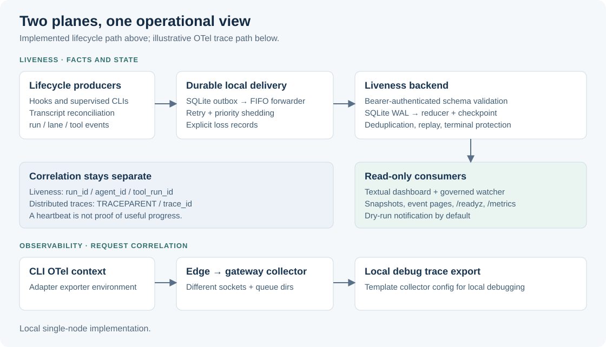
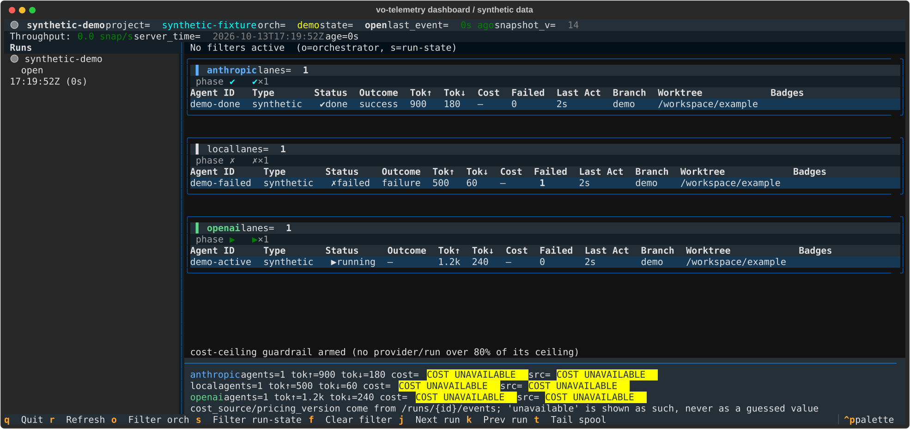

# vo-telemetry · Agent telemetry and liveness

[](https://github.com/Buckeyes22/vo-telemetry/actions/workflows/ci.yml)

An event-sourced Python platform that answers three questions about long-running
AI agent work: is the agent still running, is it making progress, and what
happened when a tool or producer failed. It combines durable lifecycle delivery,
deterministic state reduction and a read-only terminal dashboard.

## The engineering problem

A trace shows how a request executed. It does not establish whether a long-lived
agent is still running, waiting, stalled or finished. Short-lived hooks also
cannot reliably own delivery retries. vo-telemetry separates two concerns:
OpenTelemetry trace correlation for request diagnosis, and explicit run/lane/tool
facts for liveness. A local outbox bridges producer lifetime and backend
availability.



## Capabilities

| Capability | Implementation |
| --- | --- |
| Durable producer delivery | SQLite outbox, per-source FIFO, retry with jitter, priority shedding and explicit loss reports |
| Event-sourced state | Token-authenticated ingest, schema bounds, event deduplication, ordered replay and terminal-state protection |
| Agent supervision | Hooks, transcript tailing and supervised Codex/opencode/Qwen adapters; child exit codes remain visible |
| Operational view | Textual provider lanes, token/cost provenance, readiness gate, health feedback and cost-ceiling indicators |
| Governed watcher | Incident analysis, dry-run by default, action allowlist, intervention limits, cooldown and audit records |
| Diagnostics | Prometheus-format metrics for lane state, reducer progress, WAL size, backlog and reported event loss |

The test suite and a local HTTP/restart-replay smoke check run in CI on every
push to main and every pull request. Model CLIs and Telegram are exercised with fake executables and mocked
transport. See [testing](docs/testing.md) and
[engineering decisions and limits](docs/engineering-decisions.md).

## Try it locally

Use Python 3.11+ from the repository root. The core demo needs no dependencies,
model account or credentials:

```bash
PYTHONPATH=src python3 examples/local_demo.py
```

This starts `127.0.0.1:8723`, creates a temporary database and ingests a
synthetic run with a completed lane over HTTP. The run stays open while the demo
serves; Ctrl-C closes it and removes temporary storage. The terminal prints the
run ID and snapshot URL. In a second terminal:

```bash
curl --fail http://127.0.0.1:8723/readyz
curl --fail http://127.0.0.1:8723/runs/current
```

For the dashboard, in that second terminal:

```bash
python3 -m venv .venv
. .venv/bin/activate
python -m pip install -r requirements-dashboard.txt
PYTHONPATH=src python -m dashboards.subagent_dashboard --api-base http://127.0.0.1:8723
```



The image is exported from the running dashboard against a local backend fed
with synthetic events. [Reproduce the capture](docs/testing.md#reproduce-the-dashboard-image).

## Documentation

- [Setup and integration](docs/setup.md): demo, persistent local service, dashboard, watcher and optional hooks.
- [Configuration](docs/configuration.md): defaults, credentials, collection bounds and runtime controls.
- [Architecture](docs/architecture.md): component boundaries, delivery and state reduction.
- [API and data flows](docs/api-and-data.md): event contract, HTTP endpoints, replay and pagination.
- [Operations and troubleshooting](docs/operations.md): readiness, failure symptoms, storage and recovery.
- [Testing](docs/testing.md): reproducible commands and coverage.
- [Engineering decisions](docs/engineering-decisions.md): tradeoffs, known limitations and maturity.

## Security notes

Snapshot GET endpoints are unauthenticated and the supplied setup binds to
loopback; keep it there or put it behind authenticated access. Generated
telemetry can contain prompts, paths and summaries, so treat outbox files,
audit logs and databases as private data.

## License

[MIT](LICENSE). Python, PyYAML, pytest, Textual and the referenced container
images are distributed under their own upstream terms.
