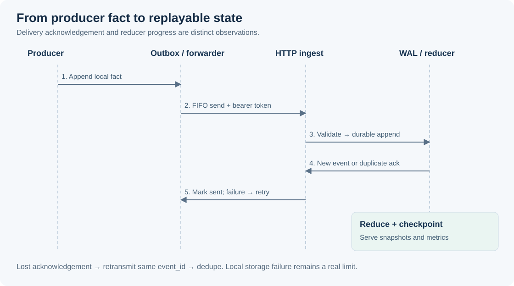

# API and data flows

[Architecture](architecture.md) · [Configuration](configuration.md) · [Source schema](../src/liveness/schema.py)

## Write path



Hooks and shims append locally. The long-lived forwarder sends the oldest
eligible unsent event for a source. A failed request updates retry timing;
success marks that row sent. The backend authenticates and validates before
inserting into SQLite. A unique event ID makes retransmission idempotent.
The reducer updates state and a progress checkpoint after the append.

These operations are not one distributed transaction. If an acknowledgement
is lost after commit, retry can recover through deduplication. Local disk errors,
storage exhaustion or a process interruption remain real failure modes.

## Event envelope

Synthetic example; use a fresh UUID and current timestamp when sending:

```json
{
  "schema_version": 1,
  "event_id": "00000000-0000-4000-8000-000000000001",
  "event_type": "lane_started",
  "ts": "2026-01-01T12:00:00Z",
  "run_id": "demo-run",
  "session_id": "demo-session",
  "orchestrator": "demo",
  "agent_id": "demo-agent",
  "provider": "demo",
  "source": "shim",
  "source_instance_id": "shim:demo-tool",
  "source_seq": 1
}
```

The fixed timestamp above deliberately documents the shape; it will be outside
the default acceptance window on later dates. The
[synthetic sender](../examples/send_synthetic_run.py) generates current values.

| Event family | Types | Meaning |
| --- | --- | --- |
| Run | `run_started`, `run_updated`, `run_closed` | Session-level lifecycle; agent ID is null or omitted |
| Lane | `lane_started`, `lane_stopped` | Attributed agent lifecycle; stop carries declared outcome |
| Tool | `tool_started`, `tool_heartbeat`, `tool_activity`, `token_delta`, `tool_completed`, `tool_failed` | Child execution and progress; requires `tool_run_id` |
| Loss | `producer_dropped_events` | Reports deliberately shed nonterminal events |

`event_id` deduplicates, `source_seq` orders one source, and server-assigned
`ingest_seq` orders replay. Producer timestamps inform age but do not replace
delivery order. `source_instance_id` must use its source prefix: `hook:`,
`shim:`, `tailer:` or `reducer:`. Unknown top-level keys are rejected; extensions
belong in `payload.ext` or `ext`. These arbitrary extensions are not a generic
secret-redaction guarantee.

Malformed or missing non-run agent IDs receive a deterministic quarantine key.
Producers must not emit derived status fields. A stopped lane's outcome is
`success`, `failure`, `partial` or `unknown`; missing outcome defaults to unknown.
The backend bounds text and stores only a final-message preview/hash by default.

## HTTP surface

The default base is `http://127.0.0.1:8723`. Only POST ingest has application
authentication. Every GET below must stay behind an appropriate trust boundary.

| Method and path | Response |
| --- | --- |
| `POST /ingest` | `202` new event; `200` duplicate with original ingest sequence |
| `GET /runs/current` | Open runs with global snapshot version and server time |
| `GET /lanes/current` | Current actionable lanes across runs, excluding historical terminal lanes |
| `GET /runs/{run_id}` | Run snapshot including lanes and tool state |
| `GET /runs/{run_id}/lanes?since_snapshot_version=N` | Lane records whose change version exceeds N |
| `GET /runs/{run_id}/events?since_ingest_seq=N&limit=L&agent_id=A` | Ordered event page with optional agent filter |
| `GET /healthz` | Process health (`200` or fatal-error `503`) |
| `GET /readyz` | WAL reachability, initialized reducer and caught-up state (`200`/`503`) |
| `GET /metrics` | Prometheus text exposition |

Clients should send `Content-Type: application/json`. The server enforces
`Content-Length` and `Authorization: Bearer <your token>` for ingest, but does
not validate the Content-Type header. Common failure codes: `401` auth,
`400` JSON/schema/timestamp, `411` missing body length, `413` oversized body,
`404` unknown path/run, and retryable `503` on the covered SQLite append/read
failure path. This is a minimal standard-library HTTP server, not a complete
hostile-network protocol gateway.

To paginate events, use the returned `next_page_token` as the next
`since_ingest_seq`; the token is the last sequence in the prior page. An absent
token means the current page is complete. `limit` is clamped to configured bounds.
URL-encode run IDs when constructing paths. Snapshot responses carry
`snapshot_version`, `last_ingest_seq_applied` and `server_time`.

Lane delta selection is based on recorded change versions. Time-derived status
can change without a new event; do not treat a lane-delta feed as a push stream
of every time-based transition. See [known limits](engineering-decisions.md).

## Restart and state interpretation

On startup the reducer rebuilds from retained WAL rows in ingest order. The
checkpoint records progress; it is not a serialized full reducer state. Missing
SQLite autoincrement slots are handled so the replay watermark can advance.
Terminal states do not regress under late nonterminal updates.

Silence projects a lane to stale/stuck. A separate last-progress timestamp can
project a heartbeating lane to stalled. Closed or abandoned runs reap orphaned
lanes; late failure ordering and read-triggered reaping have documented tradeoffs
in [engineering decisions](engineering-decisions.md).
